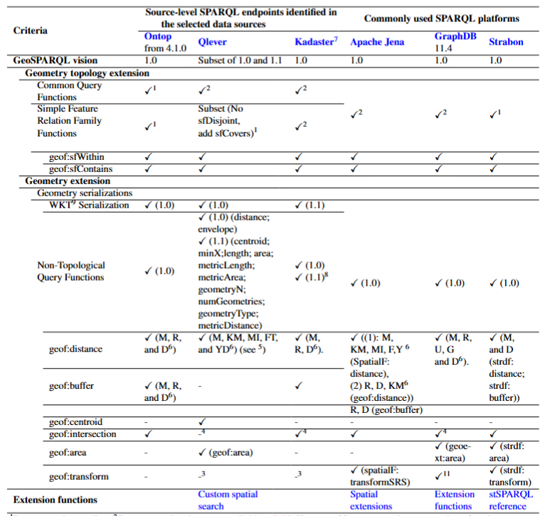

# Testing GeoSPARQL Functions in SPARQL Endpoints

---

## Endpoints and GeoSPARQL Support Documentation

| System | Endpoint / Deployment | Documentation |
|---|---|---|
| Ontop | Locally deployed SPARQL endpoint | [GeoSPARQL 1.0 Compliance](https://ontop-vkg.org/guide/compliance.html#geosparql-1-0) |
| QLever | [https://qlever.dev/osm-planet](https://qlever.dev/osm-planet) | [GeoSPARQL Support in QLever](https://docs.qlever.dev/geosparql/) |
| Kadaster | [https://data.kkg.kadaster.nl/sparql/](https://data.kkg.kadaster.nl/sparql/) | No dedicated GeoSPARQL documentation |
| Apache Jena | Locally deployed SPARQL endpoint | [GeoSPARQL Documentation](https://jena.apache.org/documentation/geosparql/) |
| GraphDB | Locally deployed SPARQL endpoint | [GeoSPARQL Support](https://graphdb.ontotext.com/documentation/11.5/sparql-ext-functions-reference.html#geosparql-functions) |
| Strabon | Locally deployed SPARQL endpoint | [Strabon](https://strabon.di.uoa.gr/) |

---

## Criteria for Determining Function Support

A function was considered **supported** when:

- The query executed successfully; and
- The returned result matched the expected result for the predefined geometries.

---

## GeoSPARQL Functions

### 1. Geometry Topology Extension: Simple Features Relation Family and Common Query Function


The following functions, which are defined identically in both GeoSPARQL 1.0 and GeoSPARQL 1.1, were tested:

| Category | Function | GeoSPARQL Version     |
|---|---|-----------------------|
| Simple Features Relation Family | `geof:sfEquals`, `geof:sfDisjoint`, `geof:sfIntersects`, `geof:sfTouches`, `geof:sfContains`, `geof:sfWithin`, `geof:sfCrosses`, `geof:sfOverlaps` | GeoSPARQL 1.0 and 1.1|
| Common Query Function | `geof:relate` | GeoSPARQL 1.0 and 1.1 |                                                                                                                              |

---

### 1.1 Ontop and Strabon: Documentation Review

For Ontop and Strabon, the available documentation was reviewed to determine whether the Simple Features relation functions and `geof:relate` are supported.

---
### 1.2 QLever, Kadaster, GraphDB, and Apache Jena: Query Tests

For QLever, Kadaster, GraphDB, and Apache Jena, support was assessed using SPARQL query tests with predefined geometries for which the expected results are known.

| Test Category | Endpoint(s) | Test / Evidence  | Purpose |
|---|---|---|---|
| Simple Features Relation Family | QLever, Kadaster, GraphDB, Apache Jena | [Simple Features Relation Family](./Geometry%20Topology%20Extension/Simple%20Features%20Relation%20Family/) | Contains the SPARQL queries used to test the Simple Features Relation Family. |
| Common Query Function | QLever, Kadaster, GraphDB, Apache Jena | [SPARQL Query 1](./Common%20Query%20Function/SPARQL%20Query%201%20for%20Common%20Query%20Function.sparql) | Tests whether `geof:relate` can be evaluated directly and return a Boolean result. |
| Common Query Function | QLever, Kadaster, GraphDB, Apache Jena | [SPARQL Query 2](./Common%20Query%20Function/SPARQL%20Query%202%20for%20Common%20Query%20Function.sparql) | Tests `geof:relate` when used inside a `FILTER`. |

---
### 2. Geometry Extension: Geometry Serializations, and Non-Topological Query Functions

| Test Category | Term / Function | GeoSPARQL Version | Description |
|---|---|---|---|
| Geometry Serializations | `geo:wktLiteral` | 1.0 and 1.1 | Datatype used for Well-Known Text (WKT) serializations of geometries. |
| Geometry Serializations | `geo:asWKT` | 1.0 and 1.1 | Links a Geometry to its WKT serialization. |
| Geometry Serializations | `geof:asWKT` | 1.1 | Converts a geometry to an equivalent WKT representation while preserving its coordinate reference system (CRS). |
| Non-Topological Query Functions | `geof:distance(?geom1, ?geom2, units)` | 1.0 and 1.1 | Returns the shortest distance between two geometries in the specified unit. |
| Non-Topological Query Functions | `geof:buffer(?geom1, radius, units)` | 1.0 and 1.1 | Returns a geometry representing all points within the specified radius of the input geometry. |
| Non-Topological Query Functions | `geof:centroid(?geom1)` | 1.1 | Returns the mathematical centroid of a geometry. |
| Non-Topological Query Functions | `geof:intersection(?geom1, ?geom2)` | 1.0 and 1.1 | Returns the geometric intersection of two geometries. |
| Non-Topological Query Functions | `geof:area(?geom1, units)` | 1.1 | Returns the area of a geometry. |
| Non-Topological Query Functions | `geof:transform(?geom1, srsIRI)` | 1.1 | Transforms a geometry to the CRS identified by `srsIRI`. |

For `geof:distance` and `geof:buffer`, the evaluated units included metre (M), kilometre (KM), statute mile (MI), foot (FT), yard (YD), radian (R), degree (D), unity (U), and grid spacing (GS).

---

### 2.1 Ontop and Strabon: Documentation Review

For Ontop, Strabon, the available documentation was reviewed to determine whether Geometry Serializations, and Non-Topological Query Functions are supported.

---

### 2.2 QLever, Kadaster, GraphDB, and Apache Jena: Query Tests
For QLever, Kadaster, GraphDB, and Apache Jena, query tests were used where applicable. Documentation was additionally consulted when implementation-specific behaviour or restrictions were documented.

| Function                      | Endpoint(s)                            | Test / Evidence                                                                                                                                                                            |
|-------------------------------|----------------------------------------|--------------------------------------------------------------------------------------------------------------------------------------------------------------------------------------------|
| `geo:wktLiteral` `geo:asWKT` `geof:asWKT` | GraphDB, Apache Jena                   | Documentation                                                                                                                                                                              |
| `geo:wktLiteral` `geo:asWKT` `geof:asWKT` | Kadaster, QLever                             | [Geometry serializations](./Geometry%20Extension/Geometry%20Serializations/Geometry%20Serializations.sparql)                                                                  |
| `geof:distance`               | QLever                                 | Documentation and [QLever distance test](https://qlever.dev/osm-planet/KAJ4aX) at 2026-07-21 15:03                                                                                         |
| `geof:distance`               | Kadaster                               | [Distance Kadaster](./Geometry%20Extension/Non-Topological%20Query%20Functions/Distance/Distance%20Kadaster.sparql)                                                                        |
| `geof:distance`               | GraphDB                                | Documentation                                                                                                                                                                              |
| `geof:distance`               | Apache Jena                            | [Distance Apache Jena](./Geometry%20Extension/Non-Topological%20Query%20Functions/Distance/Distance%20Apache%20Jena.sparql)                                                                |
| `geof:buffer`                 | QLever, Kadaster                       | [Buffer QLever and Kadaster](./Geometry%20Extension/Non-Topological%20Query%20Functions/Buffer/Buffer%20QLever%20and%20Kadaster.sparql)                                                    |
| `geof:buffer`                 | GraphDB                                | Documentation and [Buffer GraphDB](./Geometry%20Extension/Non-Topological%20Query%20Functions/Buffer/Buffer%20GraphDB.sparql)                                                              |
| `geof:buffer`                 | Apache Jena                            | [Buffer Apache Jena](./Geometry%20Extension/Non-Topological%20Query%20Functions/Buffer/Buffer%20Apache%20Jena.sparql)                                                                      |
| `geof:centroid`               | QLever                                 | Documentation                                                                                                                                                                              |
| `geof:centroid`               | Kadaster, GraphDB, Apache Jena         | [Centroid Query](./Geometry%20Extension/Non-Topological%20Query%20Functions/Centroid/Centroid.sparql)                                                                                      |
| `geof:intersection`           | QLever, Kadaster, GraphDB, Apache Jena | [Intersection Query](./Geometry%20Extension/Non-Topological%20Query%20Functions/Intersection/Intersection.sparql)                                                                          |
| `geof:area`                   | QLever                                 | Documentation                                                                                                                                                                              |
| `geof:area`                   | Kadaster, Apache Jena                  | [Area Query](./Geometry%20Extension/Non-Topological%20Query%20Functions/Area/Area.sparql)                                                                                                  |
| `geof:area`                   | GraphDB                                | Documentation                                                                                                                                                                              |
| `geof:transform`              | QLever, Kadaster                       | [Transform for QLever and Kadaster](./Geometry%20Extension/Non-Topological%20Query%20Functions/Transform%20for%20QLever%20and%20Kadaster/Transform%20for%20QLever%20and%20Kadaster.sparql) |
| `geof:transform`              | GraphDB                                | Documentation                                                                                                                                                                              |
| `geof:transform`              | Apache Jena                            | [Transform Apache Jena](./Geometry%20Extension/Non-Topological%20Query%20Functions/Transform%20Apache%20Jena/Transform%20Apache%20Jena.sparql)                                             |

---
### 3 Results


For Kadaster, GraphDB, and Apache Jena, the eight Simple Features relation functions were evaluated using query tests. The queries executed successfully, so all eight functions were considered supported.

For QLever, support was determined from the official documentation. QLever documents support for:

- `geof:sfEquals`
- `geof:sfIntersects`
- `geof:sfTouches`
- `geof:sfCrosses`
- `geof:sfWithin`
- `geof:sfContains`
- `geof:sfOverlaps`
- `geof:sfCovers`

Compared with the eight functions tested for the other endpoints, `geof:sfDisjoint` is not listed as supported by QLever, while `geof:sfCovers` is additionally supported.

However, QLever currently supports these functions only when they are used in a `FILTER` between two different geometry variables, for example:

```sparql
FILTER geof:sfIntersects(?geom1, ?geom2)
```

In this usage, the function acts as a spatial filter: only solution mappings for which the spatial relation evaluates to `true` are retained. By contrast, using the function without `FILTER`, for example:

```sparql
BIND(geof:sfIntersects(?geom1, ?geom2) AS ?result)
```

directly evaluates the function and returns a Boolean value. This direct Boolean-evaluation pattern is not supported by QLever for these functions. QLever also does not allow multiple such spatial filters on the same pair of geometry variables.

For `geof:relate`, two query patterns were tested because support also depends on how the function is used.

In Kadaster, GraphDB, and Apache Jena, both the direct Boolean-evaluation pattern in Query 1 and the `FILTER`-based pattern in Query 2 executed successfully and returned the expected results. Both tested usage patterns of `geof:relate` were therefore considered supported.

In QLever, the direct Boolean-evaluation pattern in Query 1 was not supported. However, Query 2, which uses `geof:relate` inside a `FILTER` as a spatial join, was supported.

According to the QLever implementation, the DE-9IM pattern used with `geof:relate` must:

- be a fixed string literal;
- contain exactly nine characters;
- use only `0`, `1`, `2`, `T`, `F`, or `*`; and
- represent a relation that cannot match disjoint geometries.

Therefore, QLever provides query-pattern-dependent support for both the Simple Features relation functions and `geof:relate`, with support restricted to `FILTER`-based spatial joins. In contrast, Kadaster, GraphDB, and Apache Jena supported both direct Boolean evaluation and `FILTER`-based use in the tested queries.

One implementation-specific issue should be noted for `geof:buffer (geom: ogc:geomLiteral, radius: xsd:double, units: xsd:anyURI): ogc:geomLiteral` in GraphDB. In our tests, successful buffer calculation appeared to depend on compatibility between the specified unit and the native unit of the input geometries, with similar behaviour previously reported (link: https://stackoverflow.com/questions/77773840/does-geofbuffer-work-if-so-can-someone-demonstrate-a-working-query?). For example, a geometry literal in WGS84 returned a buffer when the radius was specified in degrees but not in metres, whereas an EPSG:28992 geometry showed the opposite behaviour.

---